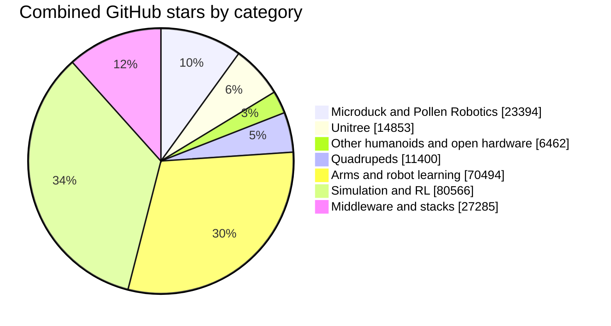

# Awesome Craft Robotics 

> A curated list of open-source robotics software and hardware, including Microduck, Unitree SDKs, open humanoids, arms, simulation and middleware.

Open-source tools now cover a large part of the robotics stack: small bipeds such as Microduck, official and community SDKs for commercial quadrupeds and humanoids, research platforms you can build, robot-learning libraries, simulators and middleware. Every GitHub entry below was checked on 2026-11-15. Check each project's licence before you train, manufacture, deploy or sell anything built on it.

**Safety:** learned policies and teleoperation stacks can move real robots with enough force to injure people or damage hardware. Test in simulation first, use a hoist or a clear workspace, keep an emergency stop within reach, and do not run an unverified policy on a robot that can reach a person. This list is not instructions, training or a substitute for that.

## Contents

- [Dashboard](#dashboard)
- [Microduck and Pollen Robotics](#microduck-and-pollen-robotics)
- [Unitree](#unitree)
- [Other humanoids and open hardware](#other-humanoids-and-open-hardware)
- [Quadrupeds](#quadrupeds)
- [Arms and robot learning](#arms-and-robot-learning)
- [Simulation and RL](#simulation-and-rl)
- [Middleware and stacks](#middleware-and-stacks)
- [Tesla Optimus](#tesla-optimus)
- [Related lists](#related-lists)
- [Star history](#star-history)

## Dashboard

<table>
<tr>
<td align="center"><h2>60</h2>listed projects</td>
<td align="center"><h2>7</h2>categories</td>
<td align="center"><h2>234.5k</h2>combined GitHub stars</td>
<td align="center"><h2>46.5k</h2>combined forks</td>
<td align="center"><h2>28/60</h2>pushed in the last 30 days</td>
<td align="center"><h2>6</h2>languages</td>
</tr>
</table>

**Evidence tags**

<table>
<tr><th>Tag</th><th>Style</th><th>Meaning</th></tr>
<tr><td>FACT</td><td>solid underline</td><td>A measured figure, with the source named.</td></tr>
<tr><td>GOAL</td><td>dashed underline</td><td>A stated roadmap, price, ship date or plan, not a result.</td></tr>
<tr><td>ESTIMATE</td><td>dotted underline</td><td>A sum or count we computed from the facts.</td></tr>
</table>

This snapshot's dashboard has no GOAL figures. None of the dashboard numbers come from project roadmaps. GOAL tags are used later for Microduck pricing and shipping claims, and for Tesla's published Optimus plans.

**Sources and method**

- Star counts, fork counts, licences, primary languages and last-push dates are FACT values from the GitHub REST API (`GET /repos/{owner}/{repo}`) on 2026-11-15.
- Combined stars (234.5k) and combined forks (46.5k) are ESTIMATEs: the arithmetic sum of those per-repository FACT counts, with no weighting and no unique-user deduplication. A person who stars two projects is counted twice.
- Pushed in the last 30 days (28/60) is an ESTIMATE: the number of listed repositories whose FACT `pushed_at` date is on or after 2026-10-16.
- Language and category counts, and the licence badges, are ESTIMATEs of FACT fields. Star badges next to each entry update live and may differ from this snapshot.

### 🏆 Leaderboard

Star counts in this table are FACT values from the snapshot. The bars are only a visual scale.

<table>
<tr><th>Rank</th><th>Project</th><th>Kind</th><th align="right">Stars</th><th></th></tr>
<tr><td align="center">🥇</td><td><b>Genesis</b></td><td>Simulation and RL</td><td align="right">30.2k</td><td><code>████████████████████</code></td></tr>
<tr><td align="center">🥈</td><td><b>LeRobot</b></td><td>Arms and robot learning</td><td align="right">28.9k</td><td><code>███████████████████</code></td></tr>
<tr><td align="center">🥉</td><td><b>MuJoCo</b></td><td>Simulation and RL</td><td align="right">18.0k</td><td><code>████████████</code></td></tr>
<tr><td align="center">4</td><td><b>openpi</b></td><td>Arms and robot learning</td><td align="right">14.7k</td><td><code>██████████</code></td></tr>
<tr><td align="center">5</td><td><b>Microduck</b></td><td>Microduck and Pollen Robotics</td><td align="right">13.8k</td><td><code>█████████</code></td></tr>
<tr><td align="center">6</td><td><b>Isaac Lab</b></td><td>Simulation and RL</td><td align="right">8.7k</td><td><code>██████</code></td></tr>
<tr><td align="center">7</td><td><b>Isaac GR00T</b></td><td>Arms and robot learning</td><td align="right">8.4k</td><td><code>██████</code></td></tr>
<tr><td align="center">8</td><td><b>SO-ARM100</b></td><td>Arms and robot learning</td><td align="right">8.1k</td><td><code>█████</code></td></tr>
<tr><td align="center">9</td><td><b>ROS 2</b></td><td>Middleware and stacks</td><td align="right">6.3k</td><td><code>████</code></td></tr>
<tr><td align="center">10</td><td><b>OpenCat</b></td><td>Quadrupeds</td><td align="right">5.6k</td><td><code>████</code></td></tr>
</table>

### Stars by category

These category totals are ESTIMATE sums of the per-repository FACT star counts.

### Licences

      

These badge counts are ESTIMATE tallies of the SPDX identifier GitHub returned for each repository. "Custom" or "None" means GitHub could not match a standard SPDX licence. Some projects also ship non-commercial or unresolved asset licences alongside OSI-licensed code, which are flagged in the entry. Read each project licence before you use it commercially.

## Microduck and Pollen Robotics

Microduck is a small biped from Pollen Robotics, the Bordeaux robotics team at Hugging Face. Pollen's [press kit](https://pollen-robotics.com/microduck/press-kit/) states an introductory price of $399 before taxes and shipping, with pre-orders opening on 27 August 2026 and first deliveries targeted before Christmas 2026. [PCMag](https://uk.pcmag.com/ai/166941/meet-microduck-a-399-open-source-robot-that-can-learn-new-tricks) reported the same price and delivery target on 27 August 2026. The price and delivery window are GOALs: they are stated offers and targets, not a confirmed shipment record. The press kit also says the open-source claim covers the software stack, not the mechanical or electronic design files.

- [Microduck](https://github.com/pollen-robotics/microduck) - Rust runtime for Pollen Robotics' small biped, with onboard control daemons, updates and policy playback. The code is Apache-2.0. Pollen is Hugging Face's robotics team. The mechanical and electronic design files are not open source, per Pollen's press kit. 
- [Microduck RL](https://github.com/pollen-robotics/microduck_rl) - Reinforcement-learning environments for Microduck, built on mjlab and MuJoCo with PPO and sim-to-real export. The code is Apache-2.0, but the STL meshes are CC BY-NC-SA 4.0, which is not an OSI licence and bars commercial use of those models. 
- [Microduck ROS 2 Isaac](https://github.com/osrbot/microduck-ros2-isaac) - Community integration of the public Microduck model with ROS 2 Jazzy and NVIDIA Isaac Sim. 
- [Microduck Simulator](https://github.com/librezoo/microduck-simulator) - Browser simulator that runs Microduck-compatible policies in MuJoCo compiled to WebAssembly. The code is Apache-2.0, but the project's asset inventory still lists separately licensed and unresolved PENDING files, so the runnable distribution must not be described as wholly open source until those are cleared. 
- [Open Duck Mini](https://github.com/apirrone/Open_Duck_Mini) - Community open-source mini biped, with design, training and assembly resources. Last pushed on 2026-01-31. 
- [Open Duck Mini Runtime](https://github.com/apirrone/Open_Duck_Mini_Runtime) - Onboard runtime for Open Duck Mini, used to play trained policies on the robot. GitHub reports no SPDX licence, so read the repository before you use it. Running policies on hardware can injure people and damage the robot. 
- [Reachy 2 SDK](https://github.com/pollen-robotics/reachy2-sdk) - Official Python SDK for Pollen Robotics' Reachy 2 humanoid. The last push in this snapshot was 2025-11-26. 
- [Reachy Mini](https://github.com/pollen-robotics/reachy_mini) - SDK for Reachy Mini, Pollen Robotics' small expressive robot, with Python and JavaScript APIs and a MuJoCo simulation path. The software is Apache-2.0; the project's documentation says hardware design files use a non-commercial Creative Commons licence. 

## Unitree

Official Unitree repositories are listed first by name, plus one widely used unofficial Go2 ROS 2 SDK. On 25 September 2025, [IEEE RAS](https://www.ieee-ras.org/news/exploit-allows-for-takeover-of-fleets-of-unitree-robots/) (updated 29 September 2025, relaying IEEE Spectrum) reported security issues affecting some Unitree Go2, B2, G1 and H1 platforms, and quoted a Unitree statement that it was working on fixes and firmware updates. This list does not document those issues. Keep firmware updated, review vendor advisories, and restrict how the robot is exposed on a network before you deploy.

- [Go2 ROS 2 SDK](https://github.com/abizovnuralem/go2_ros2_sdk) - Unofficial community ROS 2 SDK for Unitree Go2 Air, Pro and Edu robots, including sensor and navigation integrations. Not an official Unitree repository. 
- [Unitree LeRobot](https://github.com/unitreerobotics/unitree_lerobot) - Official Unitree fork of LeRobot for training and replaying data from the G1's dual-arm dexterous hands. This is the current name of the unitree_IL_lerobot project. GitHub reports no standard SPDX licence, so read the repository before you use it. 
- [Unitree MuJoCo](https://github.com/unitreerobotics/unitree_mujoco) - Official MuJoCo simulation and sim-to-sim path for Unitree robots. 
- [Unitree RL Gym](https://github.com/unitreerobotics/unitree_rl_gym) - Official reinforcement-learning environments for Go2, H1, H1_2 and G1, with sim-to-real deployment scripts. The last push in this snapshot was 2025-07-25; Unitree RL Lab is the more recently updated Isaac Lab counterpart. Deploying a trained policy on a physical robot can injure people and damage hardware. 
- [Unitree RL Lab](https://github.com/unitreerobotics/unitree_rl_lab) - Official reinforcement-learning implementation for Unitree robots, built on Isaac Lab. 
- [Unitree ROS](https://github.com/unitreerobotics/unitree_ros) - Official ROS 1 packages for Unitree robots. 
- [Unitree ROS 2](https://github.com/unitreerobotics/unitree_ros2) - Official ROS 2 packages for Unitree Go2, B2 and H1, using DDS-compatible messages. 
- [Unitree SDK2](https://github.com/unitreerobotics/unitree_sdk2) - Official C++ SDK version 2 for communicating with and controlling Unitree robots. 
- [Unitree SDK2 Python](https://github.com/unitreerobotics/unitree_sdk2_python) - Official Python interface for Unitree SDK2. 
- [XR Teleoperate](https://github.com/unitreerobotics/xr_teleoperate) - Official teleoperation stack for Unitree humanoids using XR devices. GitHub reports no standard SPDX licence, so read the repository before you use it. 

## Other humanoids and open hardware

- [AgiBot X1 Infer](https://github.com/AgibotTech/agibot_x1_infer) - Official inference module for AgiBot's X1 humanoid. GitHub reports no standard SPDX licence, so read the repository before you use it. The last push in this snapshot was 2025-04-03. 
- [Berkeley Humanoid Lite](https://github.com/HybridRobotics/berkeley-humanoid-lite) - Open-source, 3D-printable research humanoid from UC Berkeley, with policy training, simulation and real-robot deployment code. 
- [Booster Robotics SDK](https://github.com/BoosterRobotics/booster_robotics_sdk) - Official C++ SDK for Booster Robotics products. GitHub reports no standard SPDX licence, so read the repository before you use it. 
- [Fourier Aurora SDK](https://github.com/FFTAI/fourier_aurora_sdk) - Official Aurora SDK from Fourier Intelligence for its humanoid platforms. GitHub reports no standard SPDX licence, so read the repository before you use it. 
- [InMoov](https://github.com/MyRobotLab/InMoov) - Community software repository for the InMoov 3D-printable humanoid. GitHub reports no SPDX licence, so read the repository and the project's own terms before you use it. The last push in this snapshot was 2025-01-06. 
- [K-Bot](https://github.com/kscalelabs/kbot) - Open-source humanoid project from K-Scale Labs. The last push in this snapshot was 2025-11-07. 
- [Poppy Humanoid](https://github.com/poppy-project/poppy-humanoid) - Open-source, 3D-printed humanoid for research and education. GitHub reports no SPDX licence. This repository looks unmaintained, with the last push on 2021-12-06. 
- [ToddlerBot](https://github.com/hshi74/toddlerbot) - Open-source, low-cost machine-learning-oriented humanoid platform for loco-manipulation research. 

## Quadrupeds

- [Cheetah-Software](https://github.com/mit-biomimetics/Cheetah-Software) - Robot and simulation software for the MIT Mini Cheetah. This repository looks unmaintained, with the last push on 2023-10-18. 
- [OpenCat](https://github.com/PetoiCamp/OpenCat-Quadruped-Robot) - Official Petoi framework for OpenCat quadruped pets such as Bittle and Nybble, aimed at education and DIY kits. 
- [OpenCat ESP32](https://github.com/PetoiCamp/OpenCatEsp32-Quadruped-Robot) - Official ESP32-based OpenCat framework for current Petoi quadruped hardware. 
- [Pupper v3](https://github.com/Nate711/pupperv3-monorepo) - Open-source monorepo for Stanford Pupper v3, including ROS 2 code and neural-controller tooling. 
- [Solo](https://github.com/open-dynamic-robot-initiative/solo) - Low-level interface for the Open Dynamic Robot Initiative Solo torque-controlled quadruped. This repository looks unmaintained, with the last push on 2023-09-06. 
- [Stanford Quadruped](https://github.com/stanfordroboticsclub/StanfordQuadruped) - Software for the earlier Stanford Pupper servo quadruped. Last pushed on 2024-10-24; Pupper v3 is the later open codebase. 

## Arms and robot learning

- [ALOHA](https://github.com/tonyzhaozh/aloha) - Original low-cost bimanual teleoperation platform and software for ALOHA. This repository looks unmaintained, with the last push on 2024-04-19. 
- [Isaac GR00T](https://github.com/NVIDIA/Isaac-GR00T) - NVIDIA foundation-model stack for generalist robots. The repository code is Apache-2.0; model weights may use a separate NVIDIA licence, so read both before any commercial use. 
- [Koch v1.1](https://github.com/jess-moss/koch-v1-1) - Open design for the Alexander Koch low-cost leader-follower arm, used with LeRobot. Last pushed on 2024-09-17. 
- [LeRobot](https://github.com/huggingface/lerobot) - Hugging Face library for end-to-end robot learning, including dataset tools, training and real-robot policies. Deploying a policy on a physical arm can injure people and damage hardware. 
- [Mobile ALOHA](https://github.com/Interbotix/aloha) - Interbotix hardware and software package for the Mobile ALOHA bimanual mobile-manipulation platform. This repository looks unmaintained, with the last push on 2024-06-22. 
- [Octo](https://github.com/octo-models/octo) - Open transformer-based robot policy trained on a large mix of robot trajectories. This repository looks unmaintained, with the last push on 2024-07-31. 
- [openpi](https://github.com/Physical-Intelligence/openpi) - Physical Intelligence's open models and inference code for generalist robot policies, including π0 and related checkpoints. 
- [OpenVLA](https://github.com/openvla/openvla) - Open vision-language-action model for robotic manipulation. This repository looks unmaintained, with the last push on 2024-07-04. 
- [SO-ARM100](https://github.com/TheRobotStudio/SO-ARM100) - Standard Open Arm 100 hardware project, covering the SO-100 and later SO-101 low-cost arms used with LeRobot. 

## Simulation and RL

- [Brax](https://github.com/google/brax) - Massively parallel rigid-body physics simulator that runs on accelerator hardware. 
- [Gazebo](https://github.com/gazebosim/gz-sim) - Open-source robotics simulator from Open Robotics, the current Gazebo (gz-sim) line. 
- [Genesis](https://github.com/Genesis-Embodied-AI/genesis-world) - High-performance simulation platform for robotics and embodied AI. This is the current repository name for the Genesis project. 
- [Isaac Lab](https://github.com/isaac-sim/IsaacLab) - Unified robot-learning framework with multi-physics support. GitHub reports no SPDX identifier, but the repository LICENSE file is BSD-3-Clause. NVIDIA Isaac Sim itself is a separate product with its own terms. 
- [legged_gym](https://github.com/leggedrobotics/legged_gym) - Isaac Gym environments for legged robots, widely used as a training baseline. GitHub reports no standard SPDX licence, so read the repository and the Isaac Gym terms before you use it. Last pushed on 2025-05-29. 
- [ManiSkill](https://github.com/mani-skill/ManiSkill) - GPU-parallelised manipulation simulator and benchmark. This is the current organisation and repository after the move from haosulab. 
- [mjlab](https://github.com/mujocolab/mjlab) - Robot-learning framework that offers an Isaac Lab-style API on MuJoCo Warp, used to train Microduck and other policies. 
- [MuJoCo](https://github.com/google-deepmind/mujoco) - General-purpose multi-joint physics engine with contact, widely used for robot simulation and reinforcement learning. 
- [MuJoCo Playground](https://github.com/google-deepmind/mujoco_playground) - Open library of simulated and real-robot demos built on MuJoCo. 
- [MuJoCo Warp](https://github.com/google-deepmind/mujoco_warp) - GPU-optimised MuJoCo physics engine, designed for NVIDIA hardware. 
- [Webots](https://github.com/cyberbotics/webots) - Open-source robot simulator with a large library of ready-made robot models. 

## Middleware and stacks

- [Dora](https://github.com/dora-rs/dora) - Dataflow-oriented robotic middleware in Rust, aimed at low-latency AI robotics pipelines. 
- [Drake](https://github.com/RobotLocomotion/drake) - Model-based design and verification toolbox for robotics. GitHub reports no SPDX identifier; read the repository licence before you use it. 
- [micro-ROS](https://github.com/micro-ROS/micro_ros_setup) - Build support for running ROS 2 on microcontrollers. 
- [MoveIt 2](https://github.com/moveit/moveit2) - Motion planning, manipulation and control framework for ROS 2. 
- [Nav2](https://github.com/ros-navigation/navigation2) - ROS 2 navigation framework. GitHub reports no SPDX identifier; read the repository licence before you use it. 
- [Pinocchio](https://github.com/stack-of-tasks/pinocchio) - Fast rigid-body dynamics library with analytical derivatives. 
- [ROS 2](https://github.com/ros2/ros2) - Meta-repository for the Robot Operating System 2, the standard open robotics middleware. GitHub reports no SPDX licence on this tracker repository; the ROS 2 packages use their own licences, mostly Apache-2.0. 
- [ros2_control](https://github.com/ros-controls/ros2_control) - Generic controller framework for ROS 2, used to interface with real and simulated hardware. 

## Tesla Optimus

Tesla has not published open-source Optimus robot software. This snapshot found no official Optimus repository under Tesla's public GitHub organisation, [teslamotors](https://github.com/teslamotors). Unofficial projects that use the Optimus name are not Tesla code, and none are listed here.

What Tesla has published are company plans and characterisations. The [Q4 2025 Update](https://assets-ir.tesla.com/tesla-contents/IR/TSLA-Q4-2025-Update.pdf), an official Tesla investor-relations deck, said Tesla had "fine-tuned our production-primed Optimus design", planned to unveil Gen 3 in Q1 2026 as "our first design meant for mass production", and stated that start of production was planned before the end of 2026, with eventual planned capacity of 1 million robots per year. Those figures and dates are GOALs: they are Tesla's plans, not independently measured production results. This snapshot did not verify later 2026 quarterly updates.

For open-source humanoid platforms, training stacks and simulators, see the sections below. They are independent projects, not Tesla software.

## Related lists

Other lists in the Awesome Craft series:

- [Awesome Craft](https://github.com/EdisonTKPcom/Awesome-Craft) - A curated list of open-source, self-hostable alternatives to popular SaaS tools.
- [Awesome Craft Agents](https://github.com/EdisonTKPcom/Awesome-Craft-Agents) - A curated list of open-source chat apps, coding agents, self-hosted agent bots, workflow automation and image-generation UIs.
- [Awesome Craft AI](https://github.com/EdisonTKPcom/Awesome-Craft-AI) - A curated list of open-source, self-hostable AI runtimes, servers, Hugging Face libraries and related infrastructure.
- [Awesome Craft BSC](https://github.com/EdisonTKPcom/Awesome-Craft-BSC) - A curated list of verified open-source clients, SDKs, dev tools and protocol code for BNB Smart Chain and opBNB.
- [Awesome Craft CUDA](https://github.com/EdisonTKPcom/Awesome-Craft-CUDA) - A curated list of open-source CUDA learning material, kernel libraries, tooling and portability projects.
- [Awesome Craft DeepSeek](https://github.com/EdisonTKPcom/Awesome-Craft-DeepSeek) - A curated list of official DeepSeek repositories and open-source harnesses, serving engines, eval tools and fine-tuning stacks that work with DeepSeek models.
- [Awesome Craft DevOps](https://github.com/EdisonTKPcom/Awesome-Craft-DevOps) - A curated list of open-source, self-hostable alternatives to popular DevOps and hosting SaaS tools.
- [Awesome Craft DNA](https://github.com/EdisonTKPcom/Awesome-Craft-DNA) - A curated list of open-source tools for DNA, genomics and synthetic biology.
- [Awesome Craft Ethereum](https://github.com/EdisonTKPcom/Awesome-Craft-Ethereum) - A curated list of verified open-source Ethereum clients, SDKs, dev frameworks, wallets and security tools.
- [Awesome Craft EV](https://github.com/EdisonTKPcom/Awesome-Craft-EV) - A curated list of open-source software and hardware for electric vehicles and charging.
- [Awesome Craft Hardware](https://github.com/EdisonTKPcom/Awesome-Craft-Hardware) - A curated list of open-source tools for PCB, FPGA, ASIC and chip design.
- [Awesome Craft Hyperliquid](https://github.com/EdisonTKPcom/Awesome-Craft-Hyperliquid) - A curated list of verified open-source SDKs, node tools, analytics and community libraries for the Hyperliquid ecosystem.
- [Awesome Craft Jarvis](https://github.com/EdisonTKPcom/Awesome-Craft-Jarvis) - A curated list of open-source tools to run a personal JARVIS-style AI assistant locally, including dashboards, agent runtimes, voice, MCP connections and memory.
- [Awesome Craft Malaysia](https://github.com/EdisonTKPcom/Awesome-Craft-Malaysia) - A curated list of open-source tools useful to Malaysian SMEs, with verified MyInvois support called out separately.
- [Awesome Craft Mars](https://github.com/EdisonTKPcom/Awesome-Craft-Mars) - A curated list of open-source tools and open data for Mars missions and settlement planning.
- [Awesome Craft Neuro](https://github.com/EdisonTKPcom/Awesome-Craft-Neuro) - A curated list of open-source tools for brain-computer interfaces, electrophysiology and neurotechnology.
- [Awesome Craft Solana](https://github.com/EdisonTKPcom/Awesome-Craft-Solana) - A curated list of verified open-source Solana clients, SDKs, frameworks, explorers and program libraries.
- [Awesome Craft Space](https://github.com/EdisonTKPcom/Awesome-Craft-Space) - A curated list of open-source tools for spaceflight and rockets, covering orbit simulation, telemetry, launch data and more.
- [Awesome Craft Starlink](https://github.com/EdisonTKPcom/Awesome-Craft-Starlink) - A curated list of open-source tools for Starlink and other LEO satellite internet systems.
- [Awesome Craft Web3](https://github.com/EdisonTKPcom/Awesome-Craft-Web3) - A curated list of open-source DEX protocol code, self-custody software, indexers, frameworks and Blockchain infrastructure.

## Star history

## Contributing

Contributions welcome! Read the [contribution guidelines](contributing.md) first.

If this list helped you find a tool, give it a ⭐ so others can find it.

